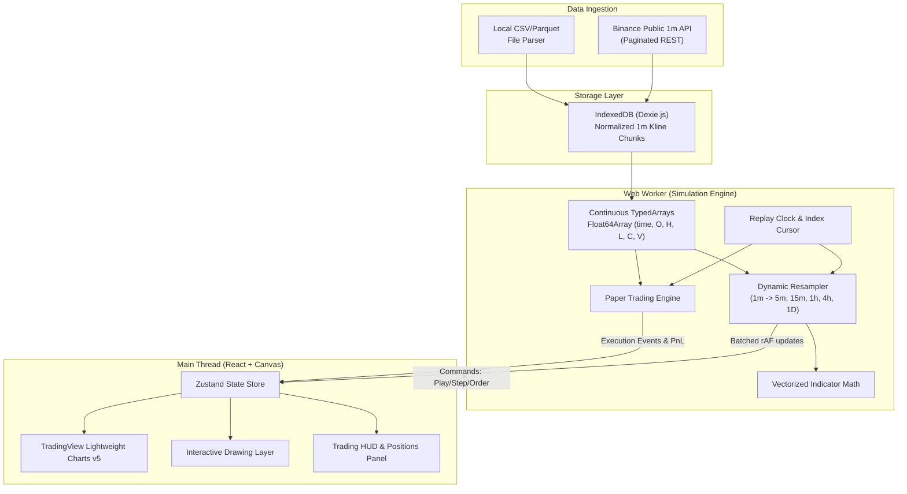

# Technical Design Specification: High-Performance TradingView Clone with 1-Minute Multi-Timeframe Replay

- **Date**: 2026-09-22
- **Status**: Approved
- **Target Platform**: Modern Web Application (Browser-first, zero install, Desktop/Tauri compatible)

---

## 1. Executive Summary
This document specifies the architecture, data structures, and implementation plan for a lightweight, high-performance TradingView clone focused on **full-featured replay functionality** down to 1-minute (and micro-tick) resolution. The system pairs TradingView's official open-source `@tradingview/lightweight-charts` engine with a dedicated Web Worker simulation core, local IndexedDB caching, dynamic multi-timeframe aggregation, drawing tools, and an integrated paper trading execution simulator.

---

## 2. Core System Architecture

### 2.1 Component Overview
The application is strictly decoupled into two main execution contexts:

1. **Main UI Thread (React 19 + TypeScript + Zustand + Tailwind CSS)**:
   - Renders TradingView-styled interface (dark theme `#131722`).
   - Manages user input, chart instances, and HUD panels.
   - Coordinates Canvas overlay for drawing tools (trendlines, rays, Fibonacci, risk/reward).
   - Throttles inbound chart updates via `requestAnimationFrame`.

2. **Dedicated Replay Web Worker**:
   - Holds the master historical 1-minute OHLCV dataset in contiguous typed arrays (`Float64Array`).
   - Executes the deterministic replay clock (play, pause, step forward/backward, jump to timestamp).
   - Computes dynamic on-the-fly higher timeframe aggregation (5m, 15m, 1h, 4h, 1D).
   - Computes technical indicator streams (SMA, EMA, RSI, MACD, Bollinger Bands).
   - Simulates order execution (market, limit, stop-loss, take-profit) against the active candle prices.



---

## 3. Data Ingestion & Storage Model

### 3.1 1-Minute Canonical Representation
All internal historical data is stored strictly at 1-minute base resolution:
```typescript
interface Candle1M {
  time: number;   // Unix timestamp in seconds (UTC)
  open: number;
  high: number;
  low: number;
  close: number;
  volume: number;
}
```

### 3.2 In-Worker Columnar TypedArrays
To prevent Garbage Collection pauses when handling hundreds of thousands of candles, the worker maintains columnar arrays:
```typescript
class CandleBuffer {
  time: Float64Array;
  open: Float64Array;
  high: Float64Array;
  low: Float64Array;
  close: Float64Array;
  volume: Float64Array;
  count: number;
}
```
* **Memory footprint**: 500,000 1-minute candles (~1 year of continuous data) consume only $\approx 24\text{ MB}$ of memory.
* **Timestamp Lookup**: Fast binary search ($O(\log N)$) allows instantaneous seeking to any date/time.

### 3.3 Data Sources
1. **Binance Public API**:
   - Endpoint: `GET https://api.binance.com/api/v3/klines?symbol={symbol}&interval=1m&limit=1000&startTime={ts}`.
   - Fetches historical chunks in batches without requiring authentication.
   - Implements exponential backoff on HTTP 429/418 status codes.
2. **Local File Import (CSV/Parquet)**:
   - Chunked streaming reader parses files up to 500MB without freezing the UI.
   - Automatic header detection matching common variations: `Timestamp/Date/Time`, `Open/O`, `High/H`, `Low/L`, `Close/C`, `Volume/V`.
3. **IndexedDB Cache (via Dexie.js)**:
   - Stores downloaded or parsed blocks keyed by `{ symbol, startTime, endTime }`.
   - Subsequent replay sessions load locally cached candles instantaneously with zero network requests.

---

## 4. Replay Clock & Dynamic Multi-Timeframe Engine

### 4.1 Replay Clock Controls
* `status`: `'IDLE' | 'PLAYING' | 'PAUSED'`
* `currentIndex`: Current index pointer into the base 1-minute `CandleBuffer`.
* `speed`: Playback frequency (0.5 bars/sec up to 60 bars/sec).
* `stepForward(n)` / `stepBackward(n)`: Moves `currentIndex` by `n` bars.
* `jumpToTimestamp(timestamp)`: Binary searches the time buffer and resets active state.
* `jumpToBar(barIndex)`: Sets pointer directly to bar index.

### 4.2 Dynamic Resampling Algorithm
When viewing timeframe $T$ (where $T \in \{1\text{m}, 3\text{m}, 5\text{m}, 15\text{m}, 30\text{m}, 1\text{h}, 4\text{h}, 1\text{D}\}$):
1. **Bucket Partitioning**:
   $$\text{bucketStart} = t - (t \bmod T_{\text{seconds}})$$
2. **Aggregation Rules**:
   - $Open$: Open of the first 1m candle within the bucket.
   - $High$: $\max_{i \in \text{bucket}} (High_i)$.
   - $Low$: $\min_{i \in \text{bucket}} (Low_i)$.
   - $Close$: Close of the most recently replayed 1m candle in the bucket.
   - $Volume$: $\sum_{i \in \text{bucket}} Volume_i$.
3. **Real-Time Active Candle Growth**:
   - For historical completed buckets up to `currentIndex`, candles are generated once.
   - For the current in-progress bucket, each replayed 1m bar dispatches an incremental `series.update(...)` event to Lightweight Charts, organically stretching the wick and body of the higher-timeframe candle.

---

## 5. Charting, Indicators & Drawing Tools Layer

### 5.1 Chart Engine Configuration
* Library: `@tradingview/lightweight-charts` v5.
* Custom theme matching TradingView:
  - Background: `#131722`
  - Grid lines: `#1e222d`
  - Bullish candles: `#26a69a`
  - Bearish candles: `#ef5350`
  - Crosshair: Synchronized price and time tracking with magnet mode.

### 5.2 Technical Indicators
Indicators run inside the Web Worker and update incrementally:
* **SMA (Simple Moving Average)**: Sliding window sum over period $N$.
* **EMA (Exponential Moving Average)**: $EMA_t = \alpha \cdot Close_t + (1 - \alpha) \cdot EMA_{t-1}$.
* **Bollinger Bands**: $\text{SMA} \pm k \cdot \sigma$ over period $N$.
* **RSI (Relative Strength Index)**: Wilder's smoothing technique on upward and downward price changes over period 14.
* **MACD**: 12/26 EMA delta with 9-period signal line and histogram.

### 5.3 Interactive Drawings Layer
* Rendered on a transparent HTML5 Canvas layer positioned directly over the chart.
* Drawing anchors are stored using **logical time (seconds)** and **price** (never raw screen pixels):
  - On chart pan/zoom or window resize, canvas redraws all tools by querying `chart.timeScale().timeToCoordinate(t)` and `series.priceToCoordinate(p)`.
* Supported tools:
  1. **Trendline**: Two anchor points with angle and length calculation.
  2. **Horizontal Ray**: One anchor point with price tag extending to the right scale.
  3. **Rectangle / Order Block**: Two anchor points (start time/price, end time/price) with semi-transparent fill.
  4. **Fibonacci Retracement**: Two anchor points calculating standard Fibonacci ratios (0, 0.236, 0.382, 0.5, 0.618, 0.786, 1.0).
  5. **Long / Short Position Tool**: Entry price, stop-loss price, and target price box displaying visual Risk:Reward ratio.

---

## 6. Paper Trading & Simulation Matcher

### 6.1 Order Matching Logic
Orders are simulated against historical candles as the replay clock advances:
* **Market Order**: Fills immediately at the `Close` of the current replayed candle.
* **Buy Limit Order**: Fills at limit price if candle $Low \le \text{LimitPrice}$.
* **Sell Limit Order**: Fills at limit price if candle $High \ge \text{LimitPrice}$.
* **Stop Loss**: Linked market order triggered when candle breaches the stop price.
* **Take Profit**: Linked limit order triggered when candle reaches the profit target.

### 6.2 Portfolio & Account State
```typescript
interface Position {
  id: string;
  symbol: string;
  side: 'LONG' | 'SHORT';
  entryPrice: number;
  size: number;
  stopLoss?: number;
  takeProfit?: number;
  unrealizedPnL: number;
  realizedPnL: number;
  openedAt: number;
}
```
* **Real-time Metrics**: Equity curve, win rate, profit factor, max drawdown, average R:R.
* **Visual Chart Markers**: Executions render Buy/Sell markers directly onto the chart candlestick series.

---

## 7. User Interface Layout

* **Top Toolbar**:
  - Symbol search & quick selector (`BTCUSDT`, `ETHUSDT`, `SOLUSDT`).
  - Timeframe toggles (`1m`, `5m`, `15m`, `1h`, `4h`, `1D`).
  - Indicators modal picker.
  - "Replay" mode button (initiates scissors/timeline jump cursor).
  - Data import button (CSV / Parquet drag-and-drop).
* **Left Toolbar**:
  - Selection cursor, Trendline, Horizontal Ray, Rectangle, Fibonacci, Long/Short tool, Trash/Clear.
* **Main Center Area**:
  - Interactive chart with volume overlay and indicator sub-panes.
* **Floating Replay HUD (Bottom)**:
  - Jump to Bar | Step Back | Play/Pause | Step Forward | Speed Slider (0.5x - 60x) | Time Scrubber.
* **Right Panel (Collapsible)**:
  - Order entry ticket (Market / Limit, Quantity, SL/TP inputs).
  - Positions & Trade History tabbed tables.

---

## 8. Verification & Testing Strategy

### 8.1 Unit Tests (Vitest)
1. **Resampler Accuracy**: Verify that 60 consecutive 1-minute test candles produce the exact expected 1-hour OHLCV candle.
2. **Indicator Validation**: Test SMA, EMA, RSI, and MACD outputs against verified reference datasets.
3. **Order Matcher**: Test limit order filling edge cases (e.g. gap openings, partial wick breaches, SL/TP priority).

### 8.2 Performance Benchmarks
* Verify 60 FPS UI responsiveness during 60x replay speed with 500,000 candles loaded.
* Verify memory usage remains under 100MB for 1 full year of 1-minute data.

---

## 9. Implementation Plan Preview
Implementation will be broken down into incremental, independently testable phases:
1. **Project Setup**: Vite + React 19 + TypeScript + Tailwind CSS + Lucide icons.
2. **Data & Storage Layer**: Dexie.js schema, Binance Kline fetcher, CSV streaming parser.
3. **Worker Core**: Replay clock, `Float64Array` buffers, multi-timeframe resampler, and message protocol.
4. **Lightweight Charts Integration**: Main chart, volume, crosshair, dynamic timeframe switching.
5. **Technical Indicators**: Vectorized math inside worker with chart series binding.
6. **Drawing Tools Canvas**: Overlay canvas, coordinate projections, tool handles, local persistence.
7. **Paper Trading Engine**: Order execution matching, positions table, live PnL, chart markers.
8. **UI Polish & Controls**: Floating replay bar, keyboard shortcuts, final performance tuning.
